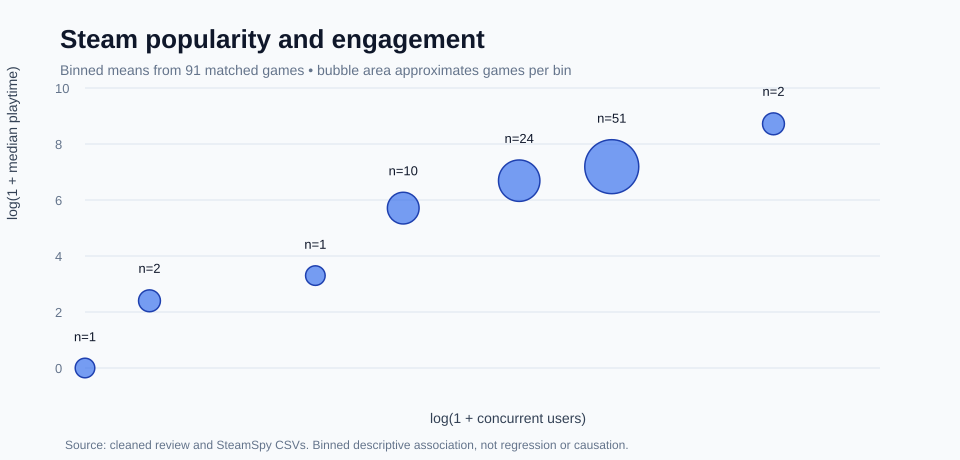
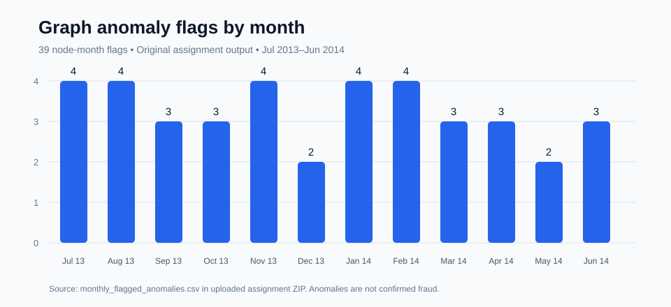
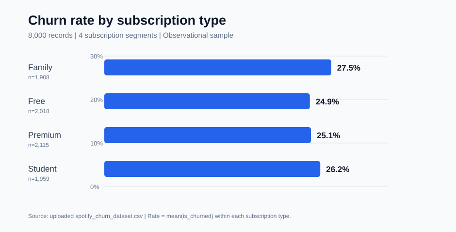

# Carina Zhao
### Data Analyst · Business Analyst · Business Intelligence

**MS Applied Analytics, Columbia University (Dec 2026) | BA Economics, UC Davis**

*Connecting technical analysis with business decisions.*

---

## About me

I'm an applied analytics graduate student with experience across **quantitative market analysis, financial reporting, business intelligence and customer analytics**. I use SQL, Python, statistical methods and dashboards to translate data into practical recommendations. This portfolio brings together selected academic projects and carefully documented professional experience.

## Selected work

| Project | Business question | Skills demonstrated | Explore |
| :--- | :--- | :--- | :--- |
| **Steam Reviews & Player Engagement** · Team project | Do reviews explain player engagement beyond game popularity? | Python · Sentiment analysis · OLS · K-Means | [Case study](projects/steam-player-engagement/README.md) · [Notebook](projects/steam-player-engagement/steam_analysis_portfolio.ipynb) · [Code excerpt](projects/steam-player-engagement/analysis_excerpt.py) |
| **Spotify Retention & Conversion** · Team project | How can user segments inform retention and conversion strategy? | Tableau · Product analytics · Cohort analysis | [Case study](projects/spotify-retention/README.md) · [Analysis plan](projects/spotify-retention/ANALYSIS_PLAN.md) |
| **Credit Card Graph Anomaly Detection** | Can network changes reveal unusual transaction relationships? | Python · Graph analytics · PageRank | [Case study](projects/credit-card-graph-anomalies/README.md) · [Methodology](projects/credit-card-graph-anomalies/METHODOLOGY.md) |
| **NYC Taxi Trip & Fare Exploration** | What patterns characterize taxi trips and fares? | Python · pandas · EDA | [Case study](projects/nyc-taxi-exploration/README.md) |
| **Sector ETF Performance & Risk** · Internship overview | How do sectors compare across market regimes and risk measures? | Python · Streamlit · VaR backtesting | [Experience overview](projects/sector-etf-risk/README.md) |
| **NYC Housing Health Score** | How can complaint records inform property-level risk screening? | SQL · MongoDB · Spark | [Project overview](projects/nyc-housing-health/README.md) |

> **Publication status:** Project documentation is live. The Steam case study includes a curated Jupyter notebook and an adapted analysis script; other complete notebooks, interactive dashboards and original screenshots are being curated and are not yet hosted. Each page states its evidence and reproducibility limits.

## How I approach analytics

## Skills

| Area | Toolkit |
| --- | --- |
| **Data analysis & programming** | Python (pandas, NumPy, Matplotlib), SQL (PostgreSQL), R |
| **Business intelligence** | Tableau, Power BI, Excel, Streamlit |
| **Data engineering** | ETL, MongoDB, Spark |
| **Analytical methods** | Regression, hypothesis testing, A/B testing, cohort and funnel analysis, customer segmentation, time-series analysis, machine learning |
| **Business applications** | KPI reporting, financial risk, customer retention, competitive research |

## Experience highlights

**Terra — Quantitative Analytics Intern (2026)**  
Analyzed 11 U.S. sector ETFs and the S&P 500, engineered risk and performance indicators, backtested a rolling VaR model and developed an interactive Streamlit dashboard.

**China Fortune Securities — Strategic Research Intern (2025)**  
Researched AI and EV companies, compared competitive positioning and market performance, and prepared industry briefs.

**SDIC Securities — Business Intelligence & Strategy Intern (2024)**  
Used SQL and Power BI to analyze spending, reconcile financial reporting metrics and support recurring expense reviews.

## Project integrity

I aim to make each case study clear about **what was analyzed, what the evidence supports and what remains uncertain**. Team projects are labeled as collaborative work. Employer-confidential materials and unlicensed datasets are excluded. See [portfolio publishing standards](CONTRIBUTING.md).

---

**Interested in data analytics, business analytics and BI opportunities.**

[Get in touch](mailto:Carinazhao409@gmail.com)

### New: Graph anomaly detection notebook

The [credit-card graph anomaly detection notebook](projects/credit-card-graph-anomalies/credit_card_graph_anomalies.ipynb) includes a full, privacy-conscious workflow for monthly PageRank, anomaly screening, and aggregate visualization. The original transaction-level data are intentionally not redistributed.

## Data-backed visual highlights

The charts below are derived from the uploaded project datasets, rather than illustrative stock graphics.

### Steam — popularity and player engagement

### Credit-card networks — monthly anomaly flags

Both are descriptive visuals. See the project pages for sample definitions and limitations.

### Spotify — churn by subscription type

The chart summarizes an uploaded 8,000-row sample; it is not an official Spotify company-wide churn statistic. See the [Spotify case study](projects/spotify-retention/README.md) for definitions and sample sizes.
