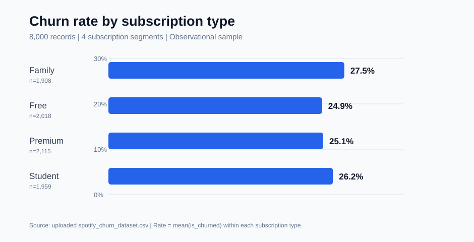

# Spotify User Retention & Conversion Analysis

**Collaborative product analytics and Tableau project**

## Business question
How do engagement, customer segments, and product-plan differences relate to retention and free-to-premium conversion?

## Approach
The uploaded project archive contains Tableau workbooks, a presentation, user-preference and churn datasets, and revenue/user-volume reference tables. The analysis is structured around customer engagement, retention, conversion, and business recommendations.

## Tools
Tableau · Python · Customer segmentation · Retention and conversion analytics

## Portfolio deliverables planned
1. Dashboard screenshots and a navigable workbook
2. Data dictionary and source/provenance notes
3. Concise findings with exact metrics verified against the final presentation
4. Recommendations and limitations

The final dashboard and numerical claims are being checked before publication. This is group work; contributions should be attributed accurately.

## My contribution
I contributed to both the **analysis and coding** and the **dashboards and visualizations** as part of the project team. The project is presented as collaborative work, not as an individual-only deliverable.

## Data-backed churn comparison

I inspected the uploaded `spotify_churn_dataset.csv` (8,000 records, 12 columns, no missing values or duplicate user IDs). The overall observed churn indicator is **25.89%**. Grouped rates: **Family 27.52% (n=1,908)**, **Student 26.19% (n=1,959)**, **Premium 25.06% (n=2,115)**, and **Free 24.93% (n=2,018)**. These are descriptive rates in the supplied sample, not Spotify's official company-wide churn metrics. The ZIP also includes a separate 1,000-row churn dataset with a different schema, plus revenue and survey files; those sources should not be silently merged.

### Original Tableau and presentation materials

The uploaded group archive contains `FinalCharts_Purpose.twbx`, `Story_Spotify.twbx`, `5800GroupCharts.twbx`, and `5800Presentation_SpotifyRentention.pdf`. The source presentation includes competitive benchmarking, willingness-to-upgrade segmentation, and risk-group analysis. **A Tableau dashboard screenshot has not yet been exported or embedded**; the figure above is independently recreated from the supplied CSV. Some presentation claims, including revenue-uplift estimates, require validation before being repeated as measured outcomes.
